# 📦 InventoryPro — Enterprise Multi-Tenant Inventory & Warehouse Management System

[](https://nodejs.org/)
[](https://react.dev/)
[](https://vitejs.dev/)
[](https://expressjs.com/)
[](https://www.mongodb.com/atlas)
[](https://razorpay.com/)
[](https://www.brevo.com/)
[](https://cloudinary.com/)
[](https://opensource.org/licenses/MIT)

> **Live Production Deployments:**  
> 🌐 **Storefront & Admin Web App (Vercel)**: [https://inventory-pro-azure-two.vercel.app/](https://inventory-pro-azure-two.vercel.app/)  
> ⚡ **Backend REST API (Render)**: [https://inventorypro-api-l20i.onrender.com](https://inventorypro-api-l20i.onrender.com)  
> 🩺 **API Healthcheck**: [https://inventorypro-api-l20i.onrender.com/](https://inventorypro-api-l20i.onrender.com/)

---

## 🎓 University Final Review Deliverables (November 2026)

All mandatory deliverables requested for the **MERN Stack Final Review** are submitted directly in this repository:

| Deliverable # | Required Item | Repository Link & Description |
| :---: | :--- | :--- |
| **1** | **Complete Project Source Code** | `Frontend/` (React 18 + Vite) & `Backend/` (Express + Mongoose ESM). Verified clean build, zero errors. |
| **2** | **Project PPT & Formal Documentation** | 📊 [Interactive Presentation Slide Deck](docs/presentation.html) • [Presentation Notes (MD)](docs/PROJECT_PRESENTATION.md)<br>📘 [Formal Project Documentation Report (PDF Ready)](docs/PROJECT_REPORT.html) • [Report (MD)](docs/PROJECT_REPORT.md) |
| **3** | **Live Deployment Links** | 🌐 [Live Storefront Web App](https://inventory-pro-azure-two.vercel.app/) • ⚡ [Live REST API](https://inventorypro-api-l20i.onrender.com) • 🩺 [Healthcheck](https://inventorypro-api-l20i.onrender.com/) |
| **4** | **README.md File & Setup Instructions** | [Full System Overview & Setup Guide](#-installation--getting-started) with architecture diagrams & credentials. |
| **5** | **Database Design & API Documentation** | 🗄️ [Comprehensive Database Design (17 Models)](docs/DATABASE_DESIGN.md)<br>🔌 [Complete REST API Specification (50+ Endpoints)](docs/API_DOCUMENTATION.md) |
| **6** | **Application Screenshots Gallery** | 📸 [High-Resolution Application Screenshots Gallery](#-application-screenshots-gallery) (11 1080p views in `screenshots/`). |

---

## 📖 Executive Summary

**InventoryPro** is an enterprise-grade, production-tested **Inventory Management System (IMS), Warehouse Management System (WMS), and Customer E-Commerce Storefront** engineered on the MERN stack (MongoDB Atlas, Express.js, React 18, Node.js).

Designed to manage high-velocity, modern supply-chain lifecycles, InventoryPro unites physical warehouse operations with digital commerce: from multi-facility inbound procurement and atomic stock deduction to customer ordering, Razorpay payment verification, instant GST invoice generation, automated 7-day customer return workflows (RMA) with automated gateway refunds, low-stock weekly schedulers, and double-entry immutable audit ledgers.

---

## 📑 Table of Contents

- [🎓 University Final Review Deliverables (November 2026)](#-university-final-review-deliverables-november-2026)
- [Executive Summary](#-executive-summary)
- [System Architecture](#-system-architecture)
- [System Personas & Role-Based Access Control (RBAC)](#-system-personas--role-based-access-control-rbac)
- [Default System Credentials](#-default-system-credentials)
- [Core Functional Modules](#-core-functional-modules)
  - [1. Product Catalog & Multi-Image Gallery](#1-product-catalog--multi-image-gallery)
  - [2. Multi-Facility Warehouse Management (WMS)](#2-multi-facility-warehouse-management-wms)
  - [3. Customer E-Commerce Storefront & Instant Checkout](#3-customer-e-commerce-storefront--instant-checkout)
  - [4. Customer Returns (RMA) & Automated Gateway Refunds](#4-customer-returns-rma--automated-gateway-refunds)
  - [5. Multi-Tiered Transactional Email Engine (Port 443 Resilient)](#5-multi-tiered-transactional-email-engine-port-443-resilient)
  - [6. Business Intelligence, Low-Stock Scheduler & Audit Logs](#6-business-intelligence-low-stock-scheduler--audit-logs)
  - [7. Immutable Double-Entry Stock Ledger](#7-immutable-double-entry-stock-ledger)
- [Technology Stack](#-technology-stack)
- [Database Architecture (17 Data Models)](#-database-architecture-17-data-models)
- [Comprehensive REST API Reference](#-comprehensive-rest-api-reference)
- [Environment Variables Guide](#-environment-variables-guide)
- [Local Installation & Development](#-local-installation--development)
- [Production Deployment Guide](#-production-deployment-guide)
- [📸 Application Screenshots Gallery](#-application-screenshots-gallery)
- [Security & Production Hardening](#-security--production-hardening)
- [Author & License](#-author--license)

---

## 🏛️ System Architecture

InventoryPro is structured into decoupled, maintainable layers following the **Controller-Service-Repository** architectural pattern:

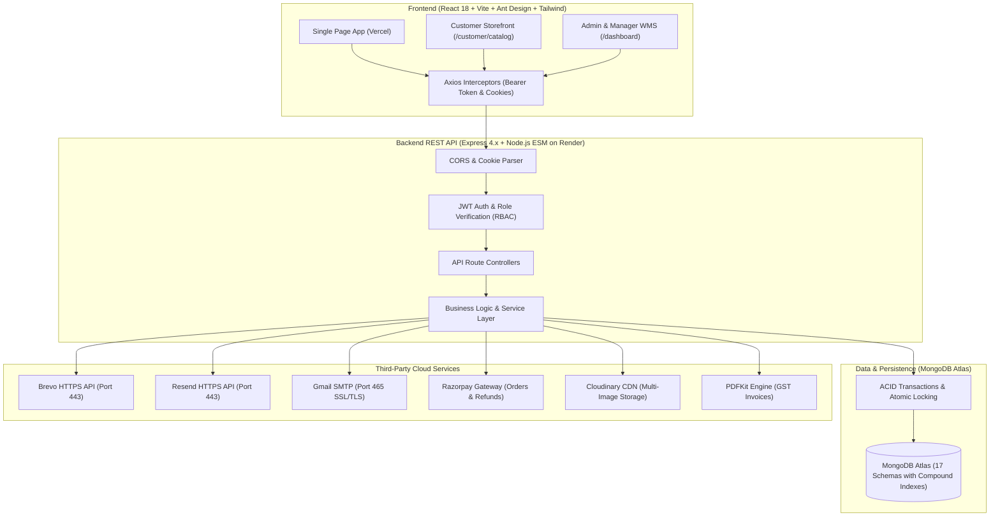

---

## 👥 System Personas & Role-Based Access Control (RBAC)

The platform enforces a strict 3-tier Role-Based Access Control (RBAC) hierarchy backed by signed JSON Web Tokens (JWT) stored in HTTP-only cookies and Authorization headers:

```
                  ┌───────────────────────────────┐
                  │       System Personas         │
                  └──────────────┬────────────────┘
                                 │
         ┌───────────────────────┼───────────────────────┐
         ▼                       ▼                       ▼
   ┌───────────┐           ┌───────────┐           ┌───────────┐
   │   Admin   │           │  Manager  │           │ Customer  │
   └─────┬─────┘           └─────┬─────┘           └─────┬─────┘
         │                       │                       │
         ├─ Full Global Access   ├─ Assigned Facilities  ├─ E-Commerce Storefront
         ├─ User & Role Mgmt     ├─ Inbound GRN (Purch.) ├─ Live Stock Browsing
         ├─ Facility Allocations ├─ Stock Transfers      ├─ Cart & Instant Checkout
         ├─ Master Stock Reports ├─ Cycle Counts / Adj.  ├─ Real-time Order Tracking
         ├─ Alert Audit Controls ├─ RMA Review & Restock ├─ Return Requests (RMA)
         ├─ Multi-Image Catalog  ├─ Warehouse Ledgers    ├─ Download PDF Invoices
         └─ Financial Overview   └─ Stock Movements      └─ Saved Shipping Profile
```

### 📋 Feature Access Matrix

| Feature / Module Capability | Administrator | Warehouse Manager | Customer |
| :--- | :---: | :---: | :---: |
| **Global Analytics & Valuation Dashboard** | ✅ Full Scope | ❌ | ❌ |
| **User & Role Management (`/admin/users`)** | ✅ Full Scope | ❌ | ❌ |
| **Create / Edit Products & Multi-Image Gallery** | ✅ Full Scope | ❌ | ❌ |
| **Bulk CSV Catalog Ingest (500 items/batch)** | ✅ Full Scope | ❌ | ❌ |
| **Warehouse Facility Setup & Address Hierarchy**| ✅ Full Scope | ❌ | ❌ |
| **Inter-Warehouse Transfers & Transit Status** | ✅ Global | ✅ Assigned Hubs | ❌ |
| **Physical Stock Cycle Counts & Adjustments** | ✅ Global | ✅ Assigned Hubs | ❌ |
| **Inbound Procurement Orders & GRN Receiving** | ✅ Global | ✅ Assigned Hubs | ❌ |
| **Customer Storefront Catalog & Cart** | ✅ Preview | ✅ Preview | ✅ Full Access |
| **Checkout (Razorpay Online / Cash on Delivery)**| ❌ | ❌ | ✅ Full Access |
| **Customer Returns Submission (RMA 7-Day Window)**| ❌ | ❌ | ✅ Full Access |
| **Review RMA & Trigger Automated Razorpay Refund**| ✅ Global | ✅ Assigned Hubs | ❌ |
| **Restock Returned Items into Facility Bin** | ✅ Global | ✅ Assigned Hubs | ❌ |
| **Low-Stock Scheduler Controls & Live Trigger** | ✅ Global | ❌ (View Logs) | ❌ |
| **Dual Admin Notification Routing** | ✅ Primary Owner | ❌ | ❌ |
| **Download Official A4 GST Tax Invoices** | ✅ Any Order | ✅ Assigned Orders | ✅ Own Orders |

---

## 🔑 Default System Credentials

To test and verify the live deployment or local installation, use the following pre-configured user credentials:

| Persona | Email Address | Password | Intended Role & Features |
| :--- | :--- | :--- | :--- |
| **Primary System Owner** | `rayapatiravitheja@gmail.com` | `Theja@1822` *(or `Admin@123`)* | Global master admin, default recipient for operational alerts, low-stock notices, order notifications, and return alerts. |
| **Global Administrator** | `admin@inventorypro.com` | `Admin@123` | System oversight, catalog management, facility management, and audit log inspection. |
| **Warehouse Manager** | `manager@inventorypro.com` | `Manager@123` | Inbound receiving, warehouse stock management, bin allocations, inter-facility transfers, return restocking. |
| **Customer User** | `99230040998@klu.ac.in` | `Customer@123` | Storefront catalog browsing, cart operations, Razorpay checkout, live order tracking, and RMA return submissions. |

---

## 🎯 Core Functional Modules

### 1. Product Catalog & Multi-Image Gallery
- **Strict SKU Schema**: Standardizes an 8-character uppercase alphanumeric SKU (`[A-Z0-9]{8}`, e.g., `MBP16001`, `ACGM0101`).
- **8-Image Gallery**: Supports up to 8 high-resolution photos per product, uploaded via Multer and stored on Cloudinary's global CDN.
- **Dynamic Cover Selection**: Allows operators to set any uploaded photo as the primary cover (`product_image`) while preserving the secondary images (`images` array).
- **Interactive UI Indicators**: Displays image count badges (`+2`, `+3`) in data tables and interactive carousel thumbnails in product drawers and storefront modals.
- **Bulk CSV Upload**: Ingests up to 500 rows per batch with per-row validation, reference resolution for categories and units, SKU deduplication, and HTTP 207 Multi-Status reporting.

### 2. Multi-Facility Warehouse Management (WMS)
- **Rigid Address Hierarchy**: Standardizes facility addresses into:
  $$\text{Street / Landmark} \longrightarrow \text{State (Dropdown)} \longrightarrow \text{City (Dropdown)} \longrightarrow \text{6-Digit PIN Code ([0-9]{6})}$$
- **Aisle / Rack / Bin Locations**: Granular bin coordinates (`A-01-01`, `F-02-15`) per product per warehouse.
- **Inter-Warehouse Transfers**: Coordinates regional inventory rebalancing between fulfillment centers with state transitions (`pending` $\rightarrow$ `in_transit` $\rightarrow$ `completed` / `cancelled`).
- **Cycle Counts & Adjustments**: Supports physical audit counts, recording variances and dispatching double-entry movements (`adjustment_add` / `adjustment_deduct`) to maintain balanced records.

### 3. Customer E-Commerce Storefront & Instant Checkout
- **Modern Responsive Storefront**: Accessible at `/customer/catalog`, featuring dynamic search, price range filtering, category tabs, and real-time stock badges (`In Stock`, `Low Stock`, `Out of Stock`).
- **Persistent Cart Engine**: Multi-item shopping cart backed by local storage and React Context, automatically computing item subtotals, standard GST (18%), and final payable amounts.
- **Payment Versatility**:
  - **Online Payment**: Integrated Razorpay modal supporting UPI, Credit/Debit Cards, NetBanking, and Wallets, verified server-side with HMAC-SHA256 signatures.
  - **Cash on Delivery (COD)**: Instant order dispatch option with automated invoice generation.
- **Branded GST Tax Invoices**: Streamed on-demand via `pdfkit`, incorporating itemized tables, HSN codes, GST calculations, company credentials, and authorized signatures.

### 4. Customer Returns (RMA) & Automated Gateway Refunds
- **7-Day Return Window**: Customers can initiate returns for delivered orders within 7 days directly from `/customer/returns`.
- **Structured Return Reasons**: Standardized categories: `Defective`, `Damaged in Transit`, `Wrong Item Received`, `Size / Fit Issue`, and `Other`.
- **Dual-Party Automated Notifications**:
  - 📧 **Customer Confirmation**: Email with return reference `#RET-XXXXXX`, item summary, and return tracking details.
  - 📧 **Admin Operational Alert**: Dispatched immediately to administrators (`rayapatiravitheja@gmail.com`, `admin@inventorypro.com`) with review links.
- **Automated Razorpay Refund**: When an administrator approves an online-paid return, the server invokes Razorpay's Refund API to credit the funds back to the customer's original payment method automatically.
- **Warehouse Restock Reconciliation**: Warehouse managers restock approved goods into specific warehouse bins, automatically incrementing stock levels and appending an `adjustment_add` entry to the Stock Ledger.

### 5. Multi-Tiered Transactional Email Engine (Port 443 Resilient)

> [!IMPORTANT]
> **The Cloud Port 465/587 Problem**: Cloud platforms like Render, AWS, and DigitalOcean block outbound SMTP ports (25, 465, 587) to prevent spam. Direct SMTP connections on these hosts time out or hang.  
> **The InventoryPro Solution**: A resilient, 3-tier email failover pipeline prioritizing HTTPS REST APIs over Port 443.

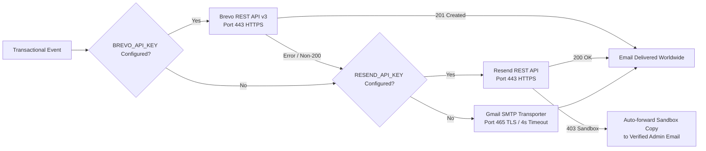

1. **Tier 1 — Brevo HTTPS API (`https://api.brevo.com/v3/smtp/email`)**:
   - Communicates via Port 443 with `api-key`.
   - Delivers to any domain worldwide without requiring custom DNS domain verification.
   - Enforces verified sender email (`rayapatiravitheja@gmail.com`).
2. **Tier 2 — Resend HTTPS API (`https://api.resend.com/emails`)**:
   - Operates over Port 443 via Bearer Token.
   - Features **Intelligent Sandbox Auto-Forwarding**: If running in test mode (`onboarding@resend.dev`), Resend rejects external recipients with HTTP 403. InventoryPro's engine catches this and routes a sandbox copy with an explanatory banner to the store owner (`rayapatiravitheja@gmail.com`).
3. **Tier 3 — Nodemailer Gmail SMTP Fallback**:
   - Configured with strict 4-second fail-fast timeouts (`connectionTimeout: 4000`, `socketTimeout: 5000`) so requests never hang if cloud firewalls block SMTP ports.
4. **Dual Admin Alerts**:
   - All critical operational events (purchase orders, customer returns, low-stock alerts, order confirmations) notify both `rayapatiravitheja@gmail.com` and `admin@inventorypro.com`.
5. **Clean Cloud Logging**:
   - Log statements use neutral terms (`notification sent to`) rather than keywords that trigger false-positive red warning flags on Render's dashboard.

### 6. Business Intelligence, Low-Stock Scheduler & Audit Logs
- **Comprehensive Reports Dashboard (`/reports`)**:
  - **Stock Report**: In-stock, low-stock ($\le 10$), and out-of-stock inventory with total catalog valuation.
  - **Sales Report**: Revenue trends, order volumes, and average order values filterable by date.
  - **Purchase Report**: Procurement expenditures, supplier fulfillments, and receiving status.
  - **Top Products**: High-velocity items ranked by revenue and units sold.
- **Low-Stock Cron Singleton (`node-cron`)**:
  - Executes every Monday at 9:00 AM IST (`0 9 * * 1`).
  - Scans product inventories across all warehouses, checking against safety thresholds.
  - Transmits branded low-stock digest emails to administrators.
- **Interactive Live Audit & Testing**:
  - Administrators can click **"Trigger Test Alerts"** in `/reports` to trigger a live catalog scan immediately.
  - **Alerts & Audit Logs Table**: Displays persistent records from the `AlertLog` collection, showing trigger method (`scheduled_cron` / `manual_test`), timestamp, recipient list, alerted SKUs, deficit counts, and gateway message IDs.

### 7. Immutable Double-Entry Stock Ledger
Every stock mutation across the system creates a permanent, non-deletable record in the `StockLedger` collection:
- `purchase_receipt`: Inward goods from supplier purchase orders (GRN).
- `order_dispatch`: Outward customer sales order fulfillment.
- `transfer_out` / `transfer_in`: Regional inter-warehouse stock movements.
- `adjustment_add` / `adjustment_deduct`: Physical count reconciliations, product stock edits, and return restocks.
- `purchase_return`: Outward return of inventory back to suppliers.

---

## 🛠️ Technology Stack

| Layer | Technology | Version | Purpose |
| :--- | :--- | :--- | :--- |
| **Frontend** | React | `^18.3.1` | Declarative component UI |
| | Vite | `^6.1.0` | Fast build tooling and HMR |
| | React Router DOM | `^7.2.0` | Client-side routing and protected routes |
| | Ant Design | `^5.24.2` | UI component library (tables, modals, forms) |
| | Tailwind CSS | `^3.4.17` | Utility-first styling |
| | Recharts & Ant Plots | `^2.15.1` / `^2.3.3` | Analytics charts and visualizations |
| | Axios | `^1.8.1` | HTTP client with JWT interceptors |
| | React Hot Toast | `^2.5.2` | Dynamic UI toast notifications |
| **Backend** | Node.js | `>=18.0.0` | Server runtime (ES Modules, `"type": "module"`) |
| | Express.js | `^4.21.2` | REST API framework |
| | MongoDB & Mongoose | `^8.10.1` | Document database and ODM |
| | JSON Web Tokens | `^9.0.2` | Authentication token signing and verification |
| | Bcrypt.js | `^3.0.2` | Password hashing (salt rounds: 10) |
| | Multer | `^1.4.5-lts.1` | Multipart/form-data upload handling |
| | Cloudinary SDK | `^2.5.1` | Image asset CDN hosting |
| | Razorpay SDK | `^2.9.8` | Payment orders and automated refunds |
| | Node-Cron | `^4.2.1` | In-process cron scheduling engine |
| | PDFKit | `^0.16.0` | Vector-based PDF tax invoice streaming |
| | Nodemailer | `^6.10.0` | SMTP client with fallback failover |

---

## 🗄️ Database Architecture (17 Data Models)

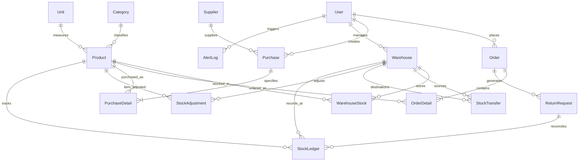

### Model Directory & Responsibilities

1. **`User`** (`user.model.js`): User accounts, bcrypt password hashes, roles (`admin`, `manager`, `customer`), assigned warehouses, verification OTPs, and refresh tokens.
2. **`Product`** (`product.model.js`): Product metadata, 8-character SKU, 8-image gallery array (`images`), primary cover (`product_image`), pricing, safety threshold, bin location, category reference, and unit reference.
3. **`Warehouse`** (`warehouse.model.js`): Facility name, warehouse code (`WH-BLR-01`), status, address (`street`, `state`, `city`, `pincode`), and capacity.
4. **`WarehouseStock`** (`warehouse-stock.model.js`): Compound mapping linking product, warehouse facility, quantity on hand, and bin/rack coordinate.
5. **`StockLedger`** (`stock-ledger.model.js`): Double-entry ledger recording `quantity_before`, `quantity_change`, `quantity_after`, `transaction_type`, and `reference_no`.
6. **`Order`** (`order.model.js`): Customer orders, invoice number (`INV-XXXXXX`), customer profile, shipping address, status (`pending`, `processing`, `shipped`, `delivered`, `cancelled`), payment method (`razorpay`, `cod`), and payment details.
7. **`OrderDetail`** (`order-detail.model.js`): Line items for orders, recording product ID, quantity, unit cost, and line total.
8. **`ReturnRequest`** (`return-request.model.js`): Customer RMA records, return number (`RET-XXXXXX`), order reference, returned items, reason, admin notes, status (`pending`, `approved`, `rejected`, `received`), and Razorpay refund ID.
9. **`AlertLog`** (`alert-log.model.js`): Audit history of low-stock alerts, trigger event, recipient list, alerted product SKUs, deficit counts, and email message IDs.
10. **`Category`** (`category.model.js`): Product classifications with admin-managed global visibility.
11. **`Unit`** (`unit.model.js`): Units of measurement (Piece, Box, Kilogram, Set, Meter, Liter).
12. **`Supplier`** (`supplier.model.js`): Vendor profiles, contact information, tax identification, and payment terms.
13. **`Customer`** (`customer.model.js`): B2B customer records and shipping profiles.
14. **`Purchase`** (`purchase.model.js`): Procurement orders (`PUR-XXXXXX`), supplier references, receiving status, and payment tracking.
15. **`PurchaseDetail`** (`purchase-detail.model.js`): Inbound purchase items, unit purchase costs, quantities ordered, and quantities received.
16. **`StockTransfer`** (`stock-transfer.model.js`): Inter-warehouse stock transit documents with transfer numbers (`TRN-XXXXXX`), dispatch timestamps, and receiving signatures.
17. **`StockAdjustment`** (`stock-adjustment.model.js`): Cycle count audit adjustments recording discrepancies between system stock and physical counts.

---

## 🔌 Comprehensive REST API Reference

Base API Path: `/api/v1`

### Standard Response Envelope
```json
{
  "statusCode": 200,
  "data": {},
  "message": "Operation successful",
  "success": true
}
```

### 1. Authentication & User Management (`/api/v1/users`)
| Method | Endpoint | Access | Description |
| :---: | :--- | :---: | :--- |
| `POST` | `/users/register` | Public | Register new user account with role selection |
| `POST` | `/users/login` | Public | Authenticate user, receive JWT access & refresh tokens |
| `POST` | `/users/logout` | Private | Revoke active refresh token and clear cookies |
| `POST` | `/users/refresh-token` | Public | Refresh expired access token using refresh token |
| `GET` | `/users/current-user` | Private | Retrieve authenticated user profile |
| `PATCH` | `/users/update-account` | Private | Update account profile details |
| `PATCH` | `/users/avatar` | Private | Upload and update user avatar |
| `POST` | `/users/send-verify-otp` | Private | Send email verification OTP |
| `POST` | `/users/verify-email` | Private | Verify account email address |
| `POST` | `/users/send-reset-otp` | Public | Send password reset OTP |
| `POST` | `/users/reset-password` | Public | Reset password using verified OTP |
| `POST` | `/users/send-change-password-otp` | Private | Validate password & send change-password OTP |
| `POST` | `/users/verify-change-password-otp`| Private | Verify change-password OTP |
| `POST` | `/users/change-password` | Private | Commit new password |

### 2. Product Catalog (`/api/v1/products`)
| Method | Endpoint | Access | Description |
| :---: | :--- | :---: | :--- |
| `GET` | `/products` | Private | List products with pagination, search, category, and warehouse filters |
| `POST` | `/products` | Admin | Create product with up to 8 images (Multer + Cloudinary) |
| `GET` | `/products/:id` | Private | Get detailed product specifications and image gallery |
| `PATCH` | `/products/:id` | Admin | Update product information, pricing, stock, and gallery |
| `DELETE` | `/products/:id` | Admin | Delete product from catalog |
| `POST` | `/products/bulk-upload` | Admin | Ingest up to 500 products via CSV with validation |

### 3. Warehouses, Transfers & Adjustments
| Method | Endpoint | Access | Description |
| :---: | :--- | :---: | :--- |
| `GET` | `/warehouses` | Private | List all regional warehouse facilities |
| `POST` | `/warehouses` | Admin | Create warehouse with state/city dropdowns & 6-digit PIN |
| `PUT` | `/warehouses/:id` | Admin | Update warehouse facility details |
| `GET` | `/warehouses/stock` | Private | Query stock quantities by warehouse |
| `POST` | `/transfers` | Manager+ | Initiate inter-warehouse stock transfer |
| `PATCH` | `/transfers/:id/status` | Manager+ | Update transfer state (`in_transit`, `completed`) |
| `POST` | `/adjustments` | Manager+ | Record physical cycle count stock adjustment |
| `GET` | `/stock-ledger` | Manager+ | Query double-entry stock ledger transactions |

### 4. Orders & Customer Checkout (`/api/v1/orders`)
| Method | Endpoint | Access | Description |
| :---: | :--- | :---: | :--- |
| `POST` | `/orders/checkout` | Customer | Customer self-service checkout (Razorpay or COD) |
| `POST` | `/orders/customer-checkout`| Customer | Alias endpoint for storefront checkout |
| `POST` | `/orders` | Manager+ | Internal order creation by staff |
| `GET` | `/orders` | Private | List orders (scoped: Customer sees own, Admin sees all) |
| `GET` | `/orders/:id` | Private | Get complete order details and line items |
| `PATCH` | `/orders/:id/status` | Manager+ | Update order status (`processing`, `shipped`, `delivered`, `cancelled`) |
| `GET` | `/orders/:id/invoice` | Private | Stream branded A4 PDF tax invoice |

### 5. Payments & Razorpay (`/api/v1/payments`)
| Method | Endpoint | Access | Description |
| :---: | :--- | :---: | :--- |
| `GET` | `/payments/config` | Private | Retrieve public Razorpay Key ID |
| `POST` | `/payments/create-order` | Customer | Create Razorpay order with currency & amount |
| `POST` | `/payments/verify` | Customer | Verify HMAC-SHA256 signature and complete order |
| `POST` | `/payments/webhook` | Public | Handle asynchronous Razorpay webhook events |

### 6. Customer Returns & RMA (`/api/v1/returns`)
| Method | Endpoint | Access | Description |
| :---: | :--- | :---: | :--- |
| `POST` | `/returns/request` | Customer | Submit return request (triggers dual-party emails) |
| `GET` | `/returns/my-returns` | Customer | View customer's own return requests |
| `GET` | `/returns` | Manager+ | List all return requests for review |
| `PATCH` | `/returns/:id/status` | Manager+ | Approve/reject return (triggers automated Razorpay refund) |
| `PATCH` | `/returns/:id/process` | Manager+ | Receive goods at facility and restock inventory |

### 7. Reports, Scheduler & Diagnostics
| Method | Endpoint | Access | Description |
| :---: | :--- | :---: | :--- |
| `GET` | `/reports/dashboard` | Manager+ | Key performance indicators and metrics |
| `GET` | `/reports/stock` | Manager+ | Real-time valuation and deficit report |
| `GET` | `/reports/sales` | Manager+ | Revenue and order volume analytics |
| `GET` | `/reports/purchases` | Manager+ | Procurement expenditures and vendor stats |
| `GET` | `/reports/top-products` | Manager+ | High-velocity product leaderboard |
| `GET` | `/scheduler/status` | Admin | Get low-stock scheduler status |
| `POST` | `/scheduler/trigger-alerts`| Admin | Manually trigger low-stock alert scan and emails |
| `GET` | `/scheduler/logs` | Manager+ | Fetch audit history of alert transmissions |
| `PUT` | `/scheduler/threshold` | Admin | Update minimum safety threshold |
| `GET` | `/test` | Public | System status and Resend key verification |
| `GET` | `/test/email?to=...` | Public | Test direct email transmission to any address |

---

## ⚙️ Environment Variables Guide

### Backend Configuration (`Backend/.env`)

```env
# Server Runtime
PORT=3001
NODE_ENV=production
FRONTEND_URL=https://inventory-pro-azure-two.vercel.app
CORS_ORIGIN=https://inventory-pro-azure-two.vercel.app
TIMEZONE=Asia/Kolkata

# Database (MongoDB Atlas)
MONGODB_URI=mongodb+srv://<user>:<password>@inventorypro-admin.7zekigd.mongodb.net/IMS?retryWrites=true&w=majority

# JWT Authentication
ACCESS_TOKEN_SECRET=your_super_secret_jwt_access_token_key_here_minimum_32_chars
ACCESS_TOKEN_EXPIRY=1d
REFRESH_TOKEN_SECRET=your_super_secret_jwt_refresh_token_key_here_minimum_32_chars
REFRESH_TOKEN_EXPIRY=10d

# Cloudinary Storage
CLOUDINARY_CLOUD_NAME=your_cloudinary_cloud_name
CLOUDINARY_API_KEY=your_cloudinary_api_key
CLOUDINARY_API_SECRET=your_cloudinary_api_secret

# Email API Tier 1: Brevo (Recommended for universal delivery over Port 443)
BREVO_API_KEY=xkeysib-your_brevo_api_key_here
BREVO_SENDER_EMAIL=rayapatiravitheja@gmail.com

# Email API Tier 2: Resend (Port 443 with Sandbox Auto-Forwarding)
RESEND_API_KEY=re_your_resend_api_key_here
RESEND_FROM="InventoryPro <onboarding@resend.dev>"

# Email Tier 3: Nodemailer Gmail SMTP Fallback
SENDER_EMAIL=your_email@gmail.com
SENDER_PASSWORD="your_gmail_16_digit_app_password"
ADMIN_EMAIL=rayapatiravitheja@gmail.com

# Razorpay Payment Gateway
RAZORPAY_KEY_ID=rzp_live_or_test_key_id
RAZORPAY_KEY_SECRET=your_razorpay_secret_key
RAZORPAY_WEBHOOK_SECRET=your_razorpay_webhook_secret
```

### Frontend Configuration (`Frontend/.env`)

```env
# Backend API Base URL
VITE_BACKEND_URL=https://inventorypro-api-l20i.onrender.com/api/v1
VITE_API_URL=https://inventorypro-api-l20i.onrender.com/api/v1
```

---

## 🚀 Local Installation & Development

### Prerequisites
- **Node.js**: `v18.0.0` or higher
- **MongoDB**: Local MongoDB instance (`127.0.0.1:27017`) or MongoDB Atlas URI
- **Git**

### 1. Clone the Repository
```bash
git clone https://github.com/rayapatiravitheja/Inventory-pro.git
cd Inventory-pro
```

### 2. Backend Setup
```bash
cd Backend
npm install

# Copy environment template and configure secrets
cp .env.example .env

# Optional: Seed default demo users (Admin, Manager, Customer)
npm run seed

# Start development server with nodemon
npm run dev
# Backend starts on http://localhost:3001
```

### 3. Frontend Setup
```bash
cd ../Frontend
npm install

# Start Vite development server
npm run dev
# Frontend starts on http://localhost:5173
```

---

## 🌐 Production Deployment Guide

### Deploying Backend on Render
1. Create a new **Web Service** on [Render](https://render.com/).
2. Connect your GitHub repository: `https://github.com/rayapatiravitheja/Inventory-pro`.
3. Set the configuration:
   - **Root Directory**: `Backend`
   - **Build Command**: `npm install`
   - **Start Command**: `npm start`
4. In the **Environment Variables** tab, add all variables from the [Backend Configuration Guide](#backend-configuration-backendenv).
5. Deploy the service.

### Deploying Frontend on Vercel
1. Import the repository on [Vercel](https://vercel.com/).
2. Set the configuration:
   - **Root Directory**: `Frontend`
   - **Framework Preset**: `Vite`
   - **Build Command**: `npm run build`
   - **Output Directory**: `dist`
3. In **Environment Variables**, set:
   - `VITE_BACKEND_URL`: `https://your-backend-service.onrender.com/api/v1`
4. Deploy the project.

---

## 📸 Application Screenshots Gallery

All views were captured in 1080p full HD from the live production deployment:

### 1. Public Storefront & Legal Policies
| Landing Page Hero & Ecosystem | Public Legal & RBI Compliance Policies |
| :---: | :---: |
| 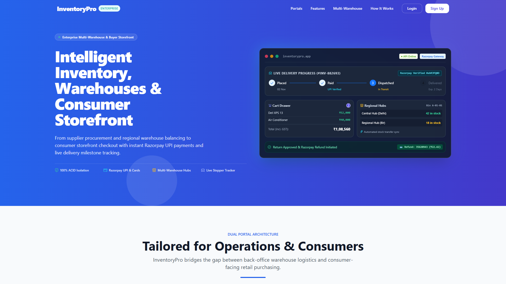 | 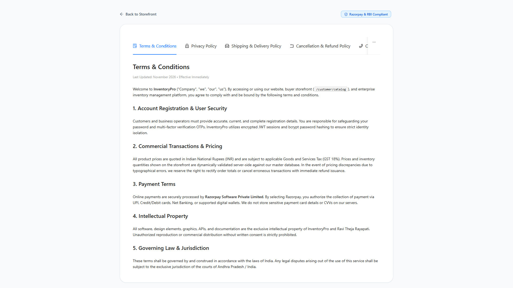 |

### 2. Customer Shopping & E-Commerce Workflow
| Customer Storefront & Live Stock Catalog | Customer Orders & Instant Tax Invoices |
| :---: | :---: |
| 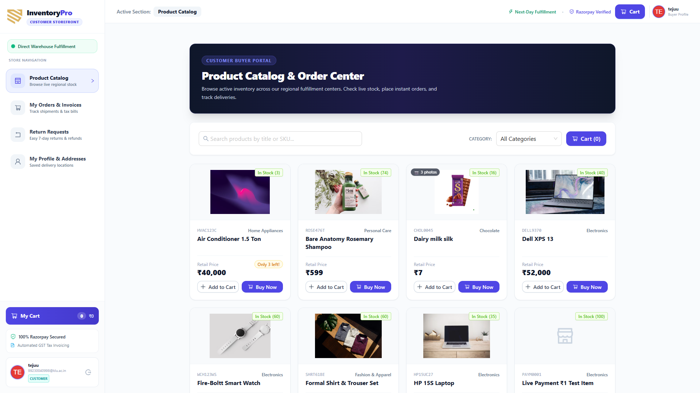 | 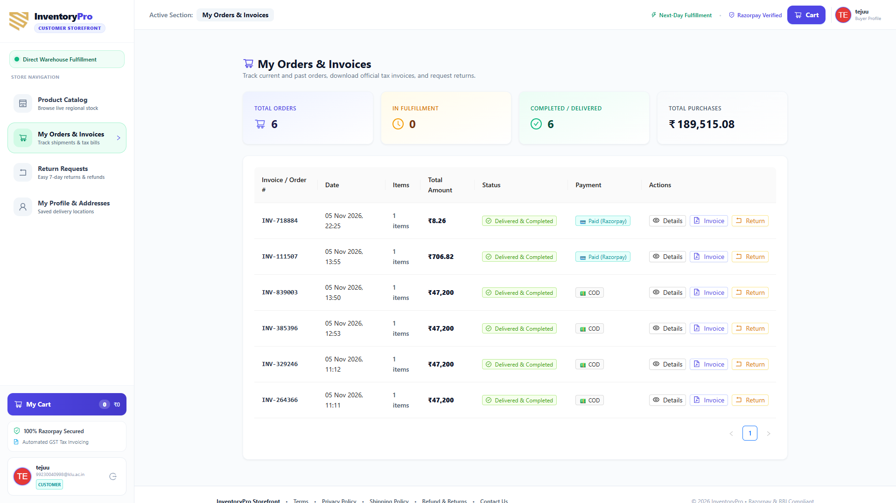 |

### 3. Customer Returns (RMA) & Administrative Operations
| Customer 7-Day Return Request (RMA) | Admin Executive Analytics Dashboard |
| :---: | :---: |
| 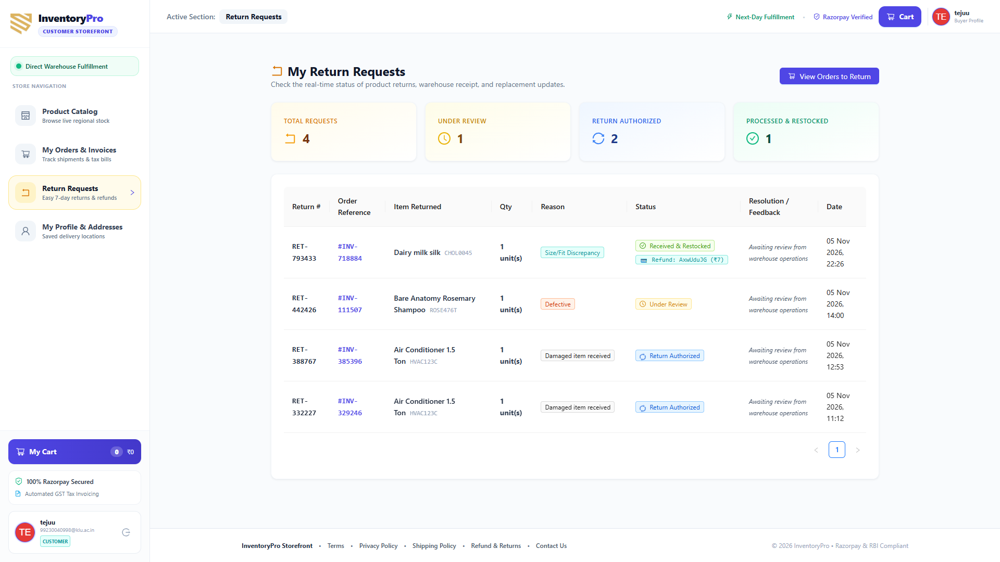 | 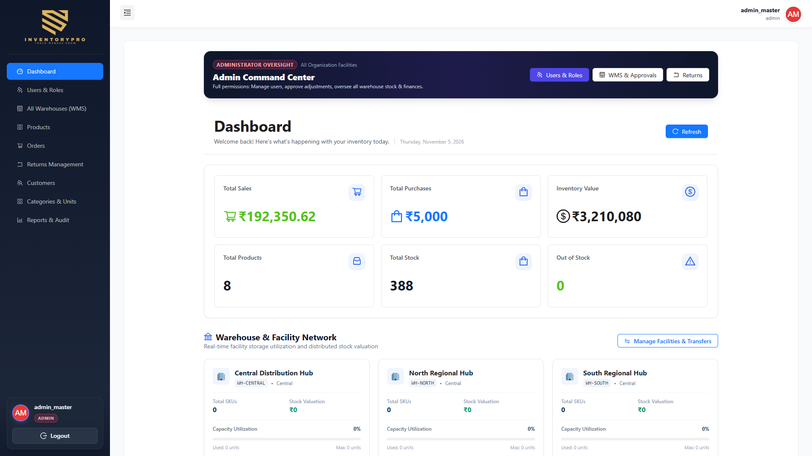 |

### 4. Warehouse Logistics & Master Catalog Management
| Multi-Facility Warehouses (WMS) | Product Master & 8-Image Cloudinary Gallery |
| :---: | :---: |
| 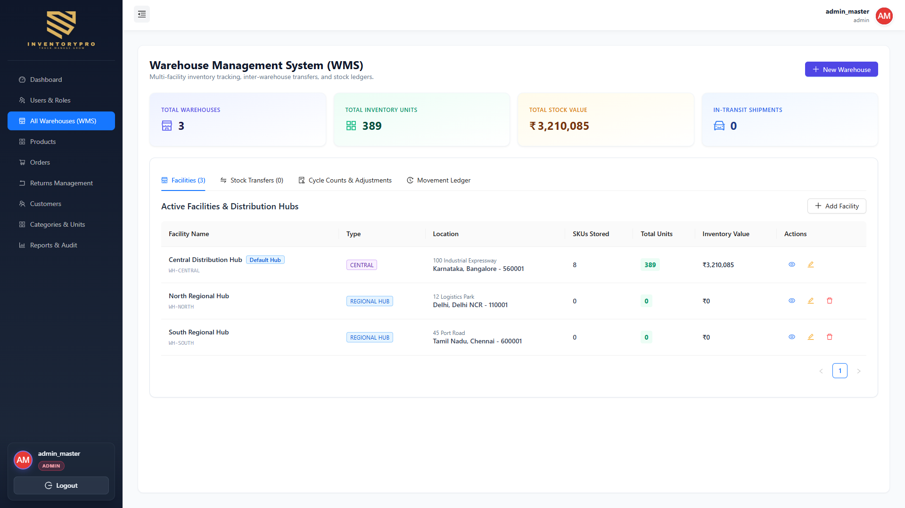 | 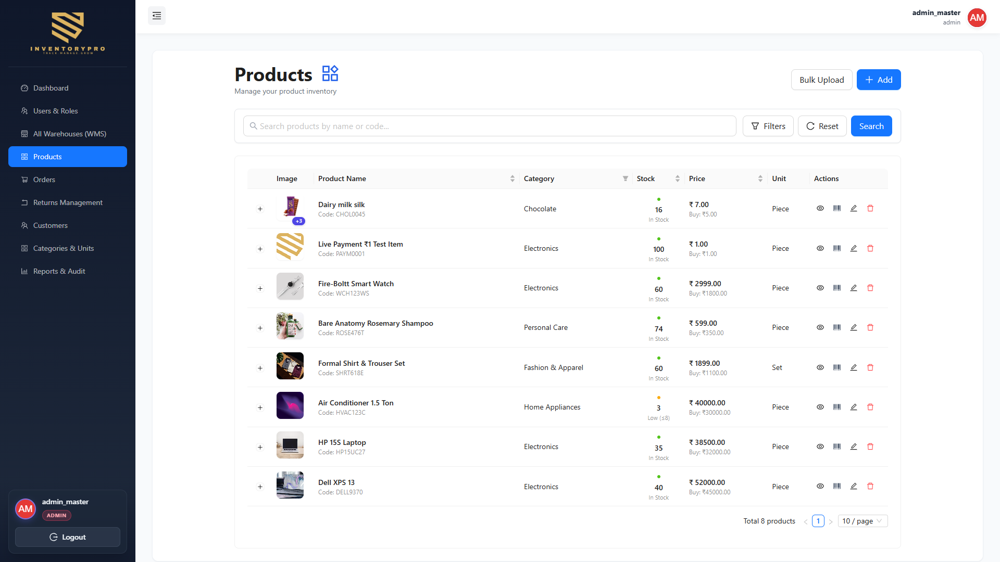 |

### 5. Automated Schedulers, Audit Trails & User Roles
| Low-Stock Alerts Engine & Audit Logs | Returns Management & Automated Refunds |
| :---: | :---: |
| 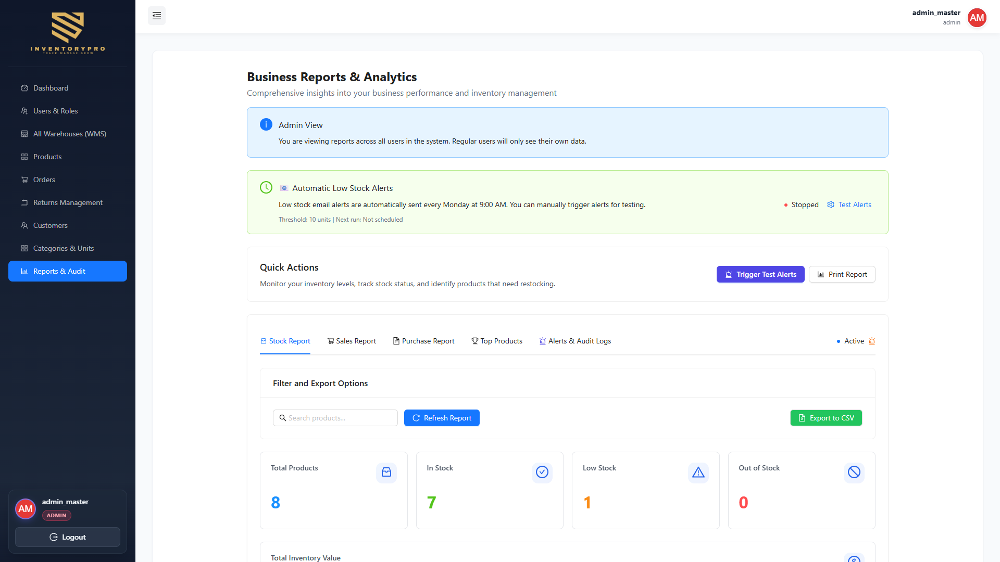 | 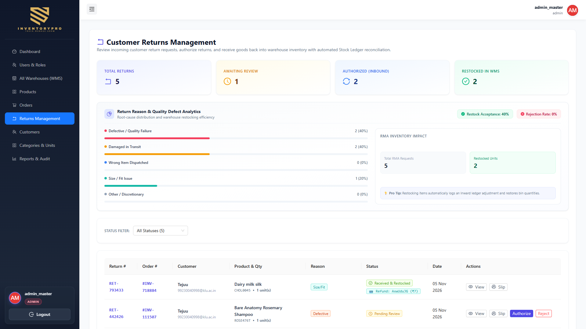 |

| User & Role Management (RBAC) |
| :---: |
| 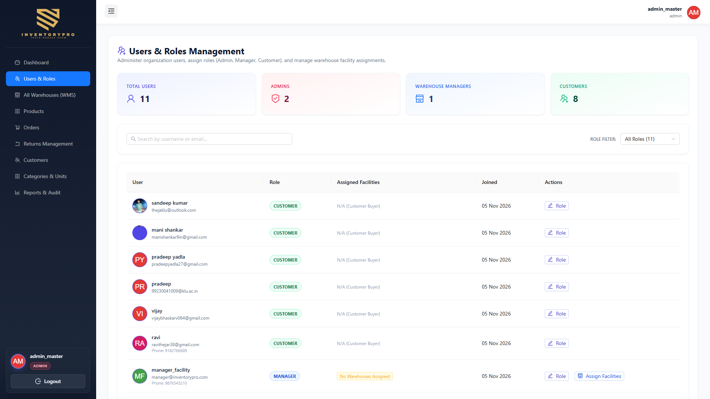 |

---

## 🔒 Security & Production Hardening

- **Bcrypt Password Security**: Passwords salted and hashed with `bcryptjs` (cost factor 10) before persistence.
- **Strict Role-Based Middleware**: Every route is guarded by both `verifyJWT` and `requireRole(...)`, preventing horizontal or vertical privilege escalation.
- **Atomic MongoDB Updates**: Inventory deductions use atomic `$gte` checks and Mongoose sessions to prevent race conditions during concurrent orders.
- **Cryptographic Payment Validation**: Razorpay payments are validated using HMAC-SHA256 signature hashes before orders are confirmed.
- **Fail-Safe Email Dispatch**: Outbound email calls run asynchronously with try/catch wrappers so email provider interruptions never block user transactions.
- **CORS Allowlist**: Express CORS policy enforces strict origin checking while allowing non-browser diagnostic requests.
- **Input Sanitization**: File uploads restricted by MIME type (`image/jpeg`, `image/png`, `image/webp`) and capped at 5MB per image.

---

## 📄 Author & License

Distributed under the **MIT License**. See `LICENSE` for more information.

- **Author**: Ravi Theja Rayapati
- **GitHub**: [@rayapatiravitheja](https://github.com/rayapatiravitheja)
- **Email**: [rayapatiravitheja@gmail.com](mailto:rayapatiravitheja@gmail.com)
- **Repository**: [https://github.com/rayapatiravitheja/Inventory-pro](https://github.com/rayapatiravitheja/Inventory-pro)

---

<div align="center">
  <strong>InventoryPro</strong> — Engineered with precision for modern supply-chain excellence.
</div>
