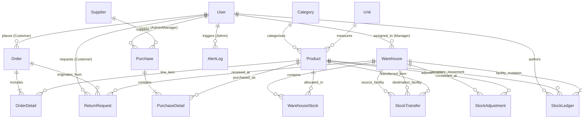

# 🗄️ InventoryPro — Comprehensive Database Architecture & Schema Specification

This document provides the formal academic and architectural database design for **InventoryPro**, an enterprise-grade multi-tenant Inventory Management System (IMS), Warehouse Management System (WMS), and E-Commerce buyer storefront.

The database is deployed on **MongoDB Atlas** using **Mongoose 8.x** Object Data Modeling (ODM). It features **17 interconnected collections**, compound index optimizations, and ACID multi-document transactions.

---

## 📑 Table of Contents
1. [Entity-Relationship (ER) Diagram](#1-entity-relationship-er-diagram)
2. [Data Model Directory & Classifications](#2-data-model-directory--classifications)
3. [Detailed Schema Data Dictionaries](#3-detailed-schema-data-dictionaries)
   - [3.1 Identity & Access Control](#31-identity--access-control)
   - [3.2 Catalog & Product Inventory](#32-catalog--product-inventory)
   - [3.3 Warehouse Management System (WMS)](#33-warehouse-management-system-wms)
   - [3.4 Customer E-Commerce & Order Lifecycle](#34-customer-e-commerce--order-lifecycle)
   - [3.5 Inbound Procurement & Vendor Logistics](#35-inbound-procurement--vendor-logistics)
   - [3.6 Automated Low-Stock Auditing & Schedulers](#36-automated-low-stock-auditing--schedulers)
4. [Indexing Strategy & Performance Optimizations](#4-indexing-strategy--performance-optimizations)
5. [Transactional Concurrency & ACID Controls](#5-transactional-concurrency--acid-controls)

---

## 1. Entity-Relationship (ER) Diagram



---

## 2. Data Model Directory & Classifications

The 17 Mongoose schemas are categorized into 6 functional operational modules:

| Domain | Model Name | Collection Name | Primary Purpose |
| :--- | :--- | :--- | :--- |
| **Identity & Access** | `User` | `users` | Multi-role user accounts, bcrypt hashes, JWT refresh tokens, shipping addresses, OTPs. |
| **Catalog** | `Product` | `products` | Master product catalog, 8-char SKU, 8-image Cloudinary gallery, pricing, safety thresholds. |
| | `Category` | `categories` | Product classifications with admin global visibility and icon tags. |
| | `Unit` | `units` | Standardized units of measurement (Piece, Box, Kilogram, Set, Meter, Liter). |
| **Warehouse (WMS)** | `Warehouse` | `warehouses` | Physical fulfillment centers, rigid state/city/PIN hierarchy, status. |
| | `WarehouseStock` | `warehousestocks` | Compound mapping of stock levels and bin/rack coordinates (`A-01-01`). |
| | `StockTransfer` | `stocktransfers` | Regional inter-facility stock movements in transit (`TRN-XXXXXX`). |
| | `StockAdjustment` | `stockadjustments` | Cycle count physical audit adjustments and variance logs. |
| | `StockLedger` | `stockledgers` | Immutable double-entry financial and inventory movement audit trail. |
| **Customer Commerce** | `Customer` | `customers` | B2B buyer profiles, tax identifiers, billing contacts. |
| | `Order` | `orders` | Sales orders, invoice numbers (`INV-XXXXXX`), Razorpay payments, fulfillment status. |
| | `OrderDetail` | `orderdetails` | Line item order breakdown, quantities, unit prices, line totals. |
| | `ReturnRequest` | `returnrequests` | 7-day customer return RMA records, categorized reasons, Razorpay refund IDs. |
| **Procurement** | `Supplier` | `suppliers` | Supplier vendor master, contact details, payment terms, bank details. |
| | `Purchase` | `purchases` | Inbound procurement purchase orders (`PUR-XXXXXX`), GRN receiving statuses. |
| | `PurchaseDetail` | `purchasedetails` | Line items for inbound purchase orders, unit costs, received counts. |
| **Scheduler & Audit** | `AlertLog` | `alertlogs` | Audit trail of weekly cron & manual low-stock alert dispatches, recipient logs, message IDs. |

---

## 3. Detailed Schema Data Dictionaries

### 3.1 Identity & Access Control

#### `User` Schema (`Backend/models/user.model.js`)
Stores authenticated personas (Administrators, Warehouse Managers, Customer Buyers).

| Field | Type | Required | Constraints / Validation | Description |
| :--- | :--- | :---: | :--- | :--- |
| `_id` | `ObjectId` | Auto | Primary Key | Unique user identifier |
| `username` | `String` | Yes | Trim, Unique, Lowercase | Unique handle for user |
| `email` | `String` | Yes | Trim, Unique, Lowercase, Regex | Email address used for authentication |
| `password` | `String` | Yes | Min length: 8 | Salted & hashed using `bcryptjs` (salt: 10) |
| `role` | `String` | Yes | Enum: `['admin', 'manager', 'customer']` | Default: `'customer'` |
| `assigned_warehouses`| `[ObjectId]` | No | Ref: `'Warehouse'` | Facilities assigned to Manager |
| `phone` | `String` | No | Trim | Contact phone number |
| `avatar` | `String` | No | Default: Dicebear SVG | CDN avatar URL |
| `shipping_addresses` | `[SubDoc]` | No | `street, state, city, pincode, is_default` | Saved customer delivery locations |
| `isVerified` | `Boolean` | No | Default: `true` | Email verification flag |
| `verifyOtp` | `String` | No | Length: 6 | Time-limited email verification OTP |
| `verifyOtpExpiry` | `Number` | No | Timestamp | Unix expiry for OTP |
| `resetOtp` | `String` | No | Length: 6 | Password reset OTP |
| `resetOtpExpiry` | `Number` | No | Timestamp | Unix expiry for password reset |
| `refreshToken` | `String` | No | JWT String | Active cryptographically signed refresh token |
| `createdAt` / `updatedAt` | `Date` | Auto | Mongoose Timestamps | Audit timestamps |

---

### 3.2 Catalog & Product Inventory

#### `Product` Schema (`Backend/models/product.model.js`)
Master inventory item record.

| Field | Type | Required | Constraints / Validation | Description |
| :--- | :--- | :---: | :--- | :--- |
| `_id` | `ObjectId` | Auto | Primary Key | Unique product identifier |
| `product_name` | `String` | Yes | Trim, Index | Title of the product |
| `product_code` | `String` | Yes | Regex: `^[A-Z0-9]{8}$`, Unique | Strict 8-char uppercase alphanumeric SKU |
| `category_id` | `ObjectId` | Yes | Ref: `'Category'` | Primary category reference |
| `unit_id` | `ObjectId` | Yes | Ref: `'Unit'` | Primary measurement unit reference |
| `buying_price` | `Number` | Yes | Min: 0 | Procurement / acquisition cost |
| `selling_price` | `Number` | Yes | Min: 0 | Retail price charged to customer |
| `stock` | `Number` | Yes | Min: 0, Default: 0 | Global aggregated on-hand quantity |
| `min_threshold`| `Number` | No | Default: 10 | Minimum safety threshold for low-stock alert |
| `product_image`| `String` | Yes | Valid URL | Designated primary cover photo |
| `product_images`| `[String]` | No | Max items: 8 | Multi-image gallery URLs (Cloudinary CDN) |
| `created_by` | `ObjectId` | Yes | Ref: `'User'` | Administrator who created product |

---

### 3.3 Warehouse Management System (WMS)

#### `Warehouse` Schema (`Backend/models/warehouse.model.js`)
Regional fulfillment and storage facilities.

| Field | Type | Required | Constraints / Validation | Description |
| :--- | :--- | :---: | :--- | :--- |
| `warehouse_name` | `String` | Yes | Trim, Unique | Facility display name (e.g. "Bengaluru Central Hub") |
| `warehouse_code` | `String` | Yes | Uppercase, Unique, Regex | Facility code (e.g. `WH-BLR-01`) |
| `is_default` | `Boolean` | No | Default: `false` | Fallback fulfillment warehouse for orders |
| `status` | `String` | No | Enum: `['active', 'inactive']` | Operating status |
| `address.street` | `String` | Yes | Trim | Street address & landmark |
| `address.state` | `String` | Yes | Indian State List | Standardized state |
| `address.city` | `String` | Yes | Standardized City List | Standardized city |
| `address.pincode`| `String` | Yes | Regex: `^[0-9]{6}$` | Valid 6-digit postal PIN code |
| `capacity` | `Number` | No | Default: 10000 | Maximum storage capacity |

#### `WarehouseStock` Schema (`Backend/models/warehouse-stock.model.js`)
Tracks inventory balances partitioned by warehouse facility and bin coordinate.

| Field | Type | Required | Constraints / Validation | Description |
| :--- | :--- | :---: | :--- | :--- |
| `warehouse_id` | `ObjectId` | Yes | Ref: `'Warehouse'` | Facility reference |
| `product_id` | `ObjectId` | Yes | Ref: `'Product'` | Product reference |
| `quantity` | `Number` | Yes | Min: 0, Default: 0 | Current physically available units |
| `reserved_quantity` | `Number` | No | Default: 0 | Stock allocated to pending orders |
| `bin_location` | `String` | No | Default: `'A-01-01'` | Aisle-Rack-Bin coordinate |

---

### 3.4 Customer E-Commerce & Order Lifecycle

#### `Order` Schema (`Backend/models/order.model.js`)
Customer sales orders, payment details, and fulfillment state.

| Field | Type | Required | Constraints / Validation | Description |
| :--- | :--- | :---: | :--- | :--- |
| `invoice_no` | `String` | Yes | Unique, Regex: `^INV-[0-9]{6}$` | Official invoice reference number |
| `customer_id` | `ObjectId` | Yes | Ref: `'Customer'` | Customer business record |
| `customer_user_id` | `ObjectId` | Yes | Ref: `'User'` | Authenticated customer user account |
| `warehouse_id` | `ObjectId` | Yes | Ref: `'Warehouse'` | Assigned fulfillment center |
| `order_date` | `Date` | Yes | Default: `Date.now` | Order placement timestamp |
| `order_status` | `String` | Yes | Enum: `['pending', 'processing', 'shipped', 'delivered', 'cancelled']` | Fulfillment state machine |
| `total_products` | `Number` | Yes | Min: 1 | Sum of item quantities |
| `sub_total` | `Number` | Yes | Min: 0 | Pre-tax order amount |
| `gst` | `Number` | Yes | 18% Standard GST | Calculated Goods and Services Tax |
| `total` | `Number` | Yes | `sub_total + gst` | Final payable amount |
| `payment_info.payment_method` | `String` | Yes | Enum: `['razorpay', 'cod']` | Selected payment gateway / method |
| `payment_info.payment_status` | `String` | Yes | Enum: `['paid', 'unpaid', 'refunded']` | Gateway settlement status |
| `payment_info.razorpay_order_id` | `String` | Conditional | Starts with `order_...` | Razorpay server order identifier |
| `payment_info.razorpay_payment_id` | `String` | Conditional | Starts with `pay_...` | Razorpay payment capture identifier |
| `payment_info.razorpay_signature` | `String` | Conditional | HMAC-SHA256 hex digest | Cryptographic verification signature |
| `payment_info.paid_at` | `Date` | No | Timestamp | Timestamp payment was confirmed |

#### `ReturnRequest` Schema (`Backend/models/return-request.model.js`)
Customer RMA tracking and automated refund engine.

| Field | Type | Required | Constraints / Validation | Description |
| :--- | :--- | :---: | :--- | :--- |
| `return_no` | `String` | Yes | Unique, Regex: `^RET-[0-9]{6}$` | Official RMA reference number |
| `order_id` | `ObjectId` | Yes | Ref: `'Order'` | Reference to originating order |
| `customer_id` | `ObjectId` | Yes | Ref: `'User'` | Customer who submitted return |
| `warehouse_id` | `ObjectId` | Yes | Ref: `'Warehouse'` | Warehouse designated for restock |
| `items` | `[SubDoc]` | Yes | `product_id, quantity, reason` | List of items being returned |
| `reason` | `String` | Yes | Enum categories | Defective, Damaged, Wrong Item, Size, Other |
| `status` | `String` | Yes | Enum: `['pending', 'approved', 'rejected', 'received']` | RMA state machine |
| `admin_notes` | `String` | No | Trim | Notes from review or refund errors |

---

### 3.5 Accounting & Ledgers

#### `StockLedger` Schema (`Backend/models/stock-ledger.model.js`)
Immutable double-entry transaction record for every inventory mutation.

| Field | Type | Required | Constraints / Validation | Description |
| :--- | :--- | :---: | :--- | :--- |
| `warehouse_id` | `ObjectId` | Yes | Ref: `'Warehouse'` | Facility where mutation occurred |
| `product_id` | `ObjectId` | Yes | Ref: `'Product'` | Mutated product reference |
| `transaction_type` | `String` | Yes | Enum: `['purchase_receipt', 'order_dispatch', 'transfer_out', 'transfer_in', 'adjustment_add', 'adjustment_deduct', 'purchase_return']` | Nature of stock mutation |
| `reference_id` | `ObjectId` | Yes | Polymorphic Ref | ID of Order, Purchase, Return, or Transfer |
| `reference_no` | `String` | Yes | Reference string | Invoice #, PO #, RMA #, or TRN # |
| `quantity_before` | `Number` | Yes | Min: 0 | Quantity prior to transaction |
| `quantity_change` | `Number` | Yes | Non-zero integer | Delta ($+$ for inward, $-$ for outward) |
| `quantity_after` | `Number` | Yes | Min: 0 | Quantity after transaction |
| `created_by` | `ObjectId` | Yes | Ref: `'User'` | User responsible for triggering event |

---

## 4. Indexing Strategy & Performance Optimizations

To guarantee sub-10ms query execution across high-volume production tables, MongoDB Atlas indexes are deployed:

```javascript
// 1. WarehouseStock: Compound unique index for instant stock queries per facility
WarehouseStockSchema.index({ warehouse_id: 1, product_id: 1 }, { unique: true });

// 2. Product: Compound search and sorting index
ProductSchema.index({ category_id: 1, selling_price: 1, stock: 1 });
ProductSchema.index({ product_code: 1 }, { unique: true });

// 3. Order: Rapid customer lookups & payment idempotency index
OrderSchema.index({ customer_user_id: 1, order_date: -1 });
OrderSchema.index({ "payment_info.razorpay_payment_id": 1 }, { sparse: true });
OrderSchema.index({ invoice_no: 1 }, { unique: true });

// 4. StockLedger: Chronological ledger audit index
StockLedgerSchema.index({ product_id: 1, warehouse_id: 1, createdAt: -1 });
StockLedgerSchema.index({ reference_no: 1 });

// 5. User: Unique identity index
UserSchema.index({ email: 1 }, { unique: true });
UserSchema.index({ username: 1 }, { unique: true });
```

---

## 5. Transactional Concurrency & ACID Controls

InventoryPro enforces strict concurrency control to prevent overselling, phantom reads, and inventory drift:

1. **MongoDB Transactions (`startTransaction` / `commitTransaction`)**:
   - Order placement executes inside a multi-document Mongoose session.
   - If payment verification fails, stock is exhausted mid-flight, or network aborts, the session triggers `abortTransaction()`, rolling back order creation, order details, and inventory changes atomically.
2. **Atomic In-Memory Deductions (`findOneAndUpdate`)**:
   - Updates enforce conditional `$gte` queries:
     ```javascript
     await Product.findOneAndUpdate(
         { _id: productId, stock: { $gte: requestedQty } },
         { $inc: { stock: -requestedQty } },
         { session }
     );
     ```
3. **Idempotency Guard**:
   - Razorpay payment IDs are verified against existing orders before processing, ensuring browser refreshes or re-transmitted webhooks never trigger duplicate stock deductions or orders.

